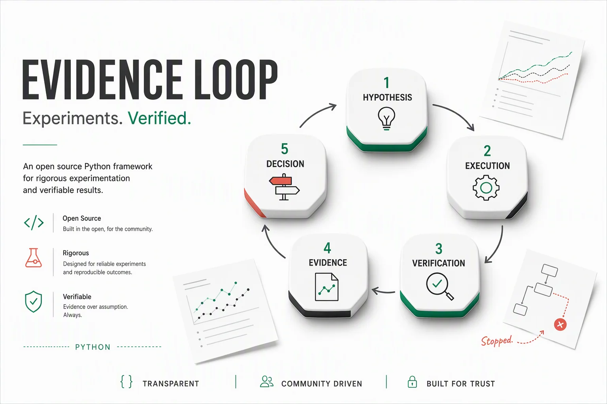
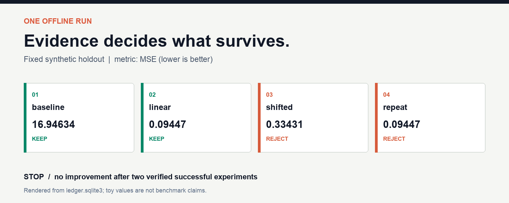

<p align="center">
  
</p>

# Evidence Loop

**A local experiment loop for coding agents. Run, verify, retain evidence, and stop.**

[](https://github.com/Chengyuann/evidence-loop/actions/workflows/ci.yml)
[](pyproject.toml)
[](LICENSE)
[](pyproject.toml)

[Quick Start](#quick-start) · [Architecture](docs/architecture.md) ·
[Agent Integration](docs/agent-integration.md) · [中文说明](README.zh-CN.md)

A promising hypothesis is not a result. A successful command is not an improvement.
An experiment without its artifacts is difficult to trust.

Evidence Loop gives a researcher or coding agent a small, deterministic execution
layer: a fixed experiment plan, bounded local commands, an attempt ledger, explicit
metric checks, and SHA-256 manifests. Failed experiments remain visible. Completed
tasks are not silently rerun. Stagnation stops the loop.

> **Status: early-stage, v0.1.0.** The bundled example demonstrates workflow
> behavior on synthetic data, not a benchmark advantage. No model provider, API
> key, cloud service, GPU, or network request is required to run it after installation.

## See the Loop

```text
Hypothesis -> Execute -> Verify -> Record evidence -> Keep / Reject
                 |         |                              |
                 +---- Failure / Timeout                  |
                           |                              |
                      Explicit retry             Next task or STOP
```

<p align="center">
  
</p>

The demo trains a mean predictor, fits a line, tests an intercept adjustment, and
repeats the linear fit. It uses one fixed synthetic holdout and then stops after
two successful experiments without improvement. The fifth planned task is not run.

## Quick Start

Python 3.9 or newer. The commands below install from this repository; the package
is not currently published to PyPI.

```bash
git clone https://github.com/Chengyuann/evidence-loop.git
cd evidence-loop
python -m venv .venv
source .venv/bin/activate
python -m pip install .

evidence-loop init workspaces/demo
evidence-loop plan --root workspaces/demo
evidence-loop run --root workspaces/demo --execute
evidence-loop report --root workspaces/demo
evidence-loop verify --root workspaces/demo
```

On Windows PowerShell, activate with `.venv\Scripts\Activate.ps1`.
`python -m evidence_loop` is equivalent to the installed `evidence-loop` command.

**Read the plan before executing.** `--execute` confirms that you trust the local
commands. This is not a sandbox. Commands inherit your environment and permissions.

Run the same workspace again:

```bash
evidence-loop run --root workspaces/demo --execute
```

There are no repeated attempts. The ledger and stopping condition survive process
restarts. To explore a different plan, create a new workspace.

## What It Does

| Capability | Behavior |
| --- | --- |
| Actual execution | Runs argv commands with `shell=False`, not repeated planning messages. |
| Durable state | SQLite transactions record each attempt and its outcome. |
| Explicit recovery | Orphaned running attempts become interrupted; retry is an operator action. |
| Evaluation identity | Requires the exact configured metric name and evaluation ID. |
| Correct comparisons | Supports minimize and maximize; only verified successes can be retained. |
| Strict improvement | A candidate must exceed the current retained score by `min_delta`. Ties do not win. |
| Bounded work | Total attempt and wall-time budgets, per-command timeout, failure and patience limits. |
| Artifact evidence | Records relative paths, byte counts, SHA-256 hashes, command and Python version. |
| Submission checks | Validates CSV shape, IDs, sample ordering, values, and duplicate headers. |
| Safe blending | Exact ID-set checks, explicit alignment, finite values, tie-aware ranks, no overwrite. |
| Machine-readable interface | JSON commands with meaningful exit codes; Markdown reports for humans. |
| Local operation | No telemetry, model calls, automatic installs, or remote submission code. |

## Bring Your Own Experiment

Start from a fresh workspace and edit its `loop.json` **before the first run**:

```json
{
  "name": "A controlled retrieval experiment",
  "metric": {"name": "recall_at_10", "direction": "maximize"},
  "evaluation_id": "dataset-v2-fixed-holdout-seed-42",
  "budget": {
    "max_steps": 6,
    "max_failures": 2,
    "patience": 2,
    "min_delta": 0.001,
    "timeout": 300,
    "max_wall_seconds": 1200
  },
  "tasks": [
    {
      "id": "baseline",
      "hypothesis": "Establish the fixed-holdout retrieval baseline.",
      "command": ["{python}", "evaluate.py", "--variant", "baseline"],
      "metrics": "metrics.json",
      "artifacts": ["predictions.csv"]
    },
    {
      "id": "reranker",
      "hypothesis": "Reranking improves recall without changing the holdout.",
      "command": ["{python}", "evaluate.py", "--variant", "reranker"],
      "metrics": "metrics.json",
      "artifacts": ["predictions.csv"]
    }
  ]
}
```

`evaluate.py` is your implementation, not an included retrieval pipeline. The
runner substitutes `{python}` with its interpreter. All other arguments are passed
literally. Commands run from the workspace directory.

Two environment variables tell your script where to write:

| Variable | Meaning |
| --- | --- |
| `EVIDENCE_LOOP_RUN_DIR` | Absolute directory of this attempt. |
| `EVIDENCE_LOOP_TASK_ID` | Current task ID. |

Write the configured metrics file using this envelope:

```python
import json
import os
from pathlib import Path

output = Path(os.environ["EVIDENCE_LOOP_RUN_DIR"])

# Compute these in your evaluator; do not ask an LLM to invent a score.
result = {
    "metric": {"name": metric_name, "value": measured_score},
    "evaluation_id": evaluation_id,
}
(output / "metrics.json").write_text(json.dumps(result, allow_nan=False) + "\n", encoding="utf-8")
```

The script must also create every declared artifact. Empty logs are allowed.
An absent artifact, wrong metric, wrong evaluation ID, non-finite score, nonzero
exit, or timeout prevents retention. This checks the output contract, **not the
scientific validity of the evaluator**.

See the [configuration and output contract](docs/configuration.md) for complete
semantics, budget accounting, retries, and path rules.

## Work With a Coding Agent

Use your agent to inspect data, propose a bounded set of hypotheses, and write
experiment code. Use Evidence Loop to execute and check that plan. The generated
workspace contains an `AGENTS.md` describing this division of responsibility.

```text
Read the workspace AGENTS.md and loop.json.
Review the evaluation split and metric implementation.
Propose one change per task with an explicit hypothesis.
Do not change the protocol after execution starts.
Show the plan before running commands.
Use the ledger and verified artifacts when reporting results.
Stop at the configured limits; do not silently retry or raise budgets.
```

No direct model integration is needed. Any tool that can invoke a local CLI can
use the same interface. There is no built-in LLM planner, autonomous research
service, or claim of independent model review.

## Daily Commands

```bash
# Execute at most one additional experiment.
evidence-loop run --root workspaces/demo --steps 1 --execute

# Inspect status without running experiments.
evidence-loop status --root workspaces/demo

# Retry a failed/interrupted task; earlier attempts stay in the ledger.
# Replace task-id with an actual failed task in your workspace.
evidence-loop retry task-id --root workspaces/demo --execute

# Validate a numeric competition submission against its sample.
evidence-loop check-submission submission.csv \
  --id-column row_id --sample sample_submission.csv

# Blend two existing predictions, aligned by ID.
evidence-loop blend first.csv second.csv \
  --id-column row_id --weight 0.25 --method mean --output blended.csv
```

Use `--allow-text` for label-valued submissions. Constant predictions produce a
warning, not an automatic failure. `--method rank` blends normalized average ranks;
its output is **not a calibrated probability** and is unsuitable for some metrics.

Exit codes: `0` successful command, `1` failed checks or unresolved failed attempts,
`2` invalid configuration or operation, `130` operator interruption. A normal
budget/patience stop can return `0`; always inspect `stop_reason`.

## Workspace Layout

```text
workspace/
  loop.json                     # Frozen plan and evaluation identity
  experiment.py                 # Your local evaluator
  AGENTS.md                     # Agent/operator contract
  ledger.sqlite3                # Local attempt history
  runs/
    baseline/
      attempt-001/
        metrics.json
        predictions.csv
        provenance.json
        stdout.log
        stderr.log
```

Runtime data, local context, logs, keys and environment files are excluded by
default. A workspace is private working material, **not automatically publishable**.

## Trust and Limitations

- **Trusted local code only.** Timeouts and path checks do not isolate a process.
  Use containers or another sandbox for untrusted code. Network and resource
  isolation are outside this release.
- **Evidence is not proof of correctness.** Hashes detect changes against the
  local ledger; they are not signatures, and the ledger itself is locally editable.
- **Review evaluation validity.** Split leakage, label leakage, noisy scores,
  statistical significance and holdout overfitting require separate review.
- **The protocol is deliberately fixed.** Config changes after the first attempt
  are rejected. Use separate workspaces for new rounds, datasets or plans.
- **Budgets are operational limits.** They do not measure API spend, GPU memory or
  token usage. Setup and process cleanup can exceed a wall-time deadline slightly.
- **Crash recovery is not process isolation.** An uncatchable runner kill may
  leave children alive. Check them before explicitly retrying. POSIX timeout
  cleanup targets the process group; Windows cleanup targets the direct child.
- **Single local runner.** Do not use a shared network filesystem or treat this as
  a distributed scheduler.
- No automatic competition submissions, leaderboard optimization, model-provider
  adapters, OOF-correlation selection, or unverified performance claims.

## Development

```bash
python -m pip install -e ".[dev]"
python -m pytest --cov=evidence_loop --cov-report=term-missing
ruff check .
ruff format --check .
python -m build
```

The tests cover happy paths and rejected outputs, budgets, retry/recovery behavior,
configuration drift, artifact tampering, locking, submission structure and blending.
See [CONTRIBUTING.md](CONTRIBUTING.md) for scope and test expectations.

## Roadmap

Potential next steps, not implemented features:

- Read-only HTML comparison reports backed by the ledger.
- Optional container execution with explicit resource and network limits.
- Multi-seed evaluation summaries and user-configured uncertainty estimates.
- Aligned OOF-correlation diagnostics for ensemble research.
- An explicit import/export contract between independently reviewed rounds.

Small, concrete use cases and reproducible bug reports are especially welcome.
Please include a minimal **synthetic** example rather than private data or logs.

## License and Credits

MIT. See [LICENSE](LICENSE). The original workflow concept and this project are
maintained by Chengyuan Ma. Documentation artwork was generated with GPT Image 2;
the demo image is rendered from an actual local run. See [asset provenance](docs/assets/README.md).
