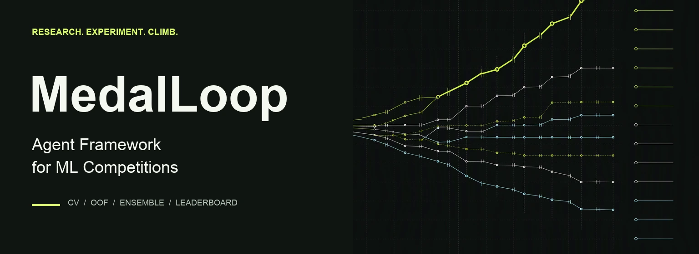
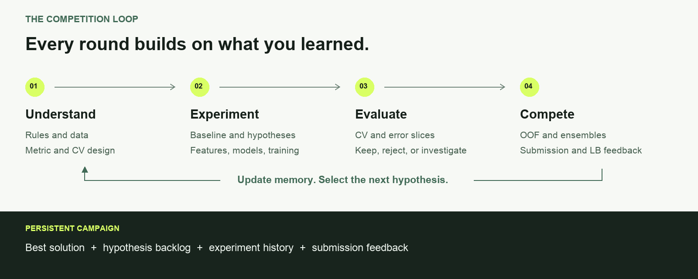

<p align="center">
  
</p>

# MedalLoop

**An Agent iteration framework for machine-learning competitions.**

[](https://github.com/Chengyuann/medalloop/actions/workflows/ci.yml)
[](pyproject.toml)
[](LICENSE)
[](pyproject.toml)

[Quick Start](#quick-start) · [How It Improves a Solution](#how-it-improves-a-solution) ·
[Competition Workflow](docs/competition-workflow.md) · [中文](README.zh-CN.md)

MedalLoop gives a coding Agent a persistent workflow for one job: **keep improving
a competition solution through trustworthy validation and controlled experiments.**

It helps the Agent move from rules and data to a reproducible baseline, maintain
a prioritized hypothesis backlog, run attributable experiments, learn from failures,
evaluate OOF complementarity, validate submissions, record official leaderboard
feedback, and carry the useful findings into the next round.

<p align="center">
  
</p>

## Why MedalLoop?

Competition campaigns often fail because the process loses discipline:

- tuning starts before the metric and validation split are trustworthy;
- multiple changes are bundled together, so gains cannot be attributed;
- failed ideas disappear and are tried again;
- public leaderboard feedback is confused with local CV;
- OOF and test predictions are missing when it is time to ensemble;
- submission IDs or columns are wrong;
- after a long Agent session, nobody knows the current best or next action.

MedalLoop turns those problems into a repeatable campaign structure:

| Need | MedalLoop provides |
| --- | --- |
| Understand the competition | Brief for rules, metric, data, compute and submission budget. |
| Resume long campaigns | Current state, hypothesis backlog and experiment/submission history. |
| Build a trustworthy baseline | Frozen evaluation identity and required OOF/prediction artifacts. |
| Run controlled experiments | One hypothesis, one command and one traceable result per task. |
| Preserve failures | Append-only attempts and explicit retries. |
| Stop unproductive tuning | Attempt, wall-time, failure and no-improvement limits. |
| Build ensembles | Strictly aligned prediction blending and OOF lineage. |
| Submit safely | Schema, ID, order, missing-value and constant-prediction checks. |

## Quick Start

Python 3.9 or newer:

```bash
git clone https://github.com/Chengyuann/medalloop.git
cd medalloop
python -m venv .venv
source .venv/bin/activate
python -m pip install .

medalloop init my-competition --competition
cd my-competition
```

On Windows PowerShell, activate the environment with `.venv\Scripts\Activate.ps1`.
The package is installed from this repository; it is not published to PyPI.

The generated campaign contains:

```text
my-competition/
├── AGENTS.md                 # complete competition-Agent workflow
├── COMPETITION.md            # task, rules, metric, data and validation brief
├── memory/
│   ├── STATE.md              # current best, active round and next action
│   ├── HYPOTHESES.md         # prioritized experiment backlog
│   └── RESULTS.md            # CV findings and official submission history
└── rounds/
    └── 001/
        ├── README.md         # what the first round still needs
        └── loop.json         # baseline experiment plan
```

Give `AGENTS.md` to Codex, Claude Code, Cursor or another coding Agent. Complete
`COMPETITION.md`, let the Agent inspect the rules and data, implement
`rounds/001/train.py`, then review and run the first experiment:

```bash
medalloop plan --root rounds/001
medalloop run --root rounds/001 --steps 1 --execute
medalloop report --root rounds/001
medalloop verify --root rounds/001
```

`--execute` confirms that you reviewed the local command. MedalLoop is not a
sandbox; competition code runs with your permissions.

To try the runner before connecting real data:

```bash
medalloop init workspaces/demo
medalloop run --root workspaces/demo --execute
medalloop report --root workspaces/demo
```

This offline synthetic example exercises comparison, rejection and stopping.
It is a runner demonstration, not a competition benchmark.

## How It Improves a Solution

### 1. Build the right local problem

The Agent records the official metric, direction, rules, submission format,
external-data policy and budgets. It inspects groups, timestamps, target balance
and other split-defining structure before choosing stratified, grouped, temporal
or another justified validation scheme.

### 2. Establish a reproducible baseline

The first goal is an end-to-end reference with fixed folds, a checked metric,
OOF predictions, test predictions, resolved configuration and a valid submission.
The baseline gives later experiments something trustworthy to beat.

### 3. Select hypotheses from evidence

The Agent combines competition-specific research, error slices, per-fold behavior,
prior failures, expected gain and compute cost. One experiment should answer one
useful question. Depending on the competition, this may involve cleaning, features,
representations, models, losses, augmentations, sampling, tuning, inference or ensembles.

### 4. Execute a controlled round

Each task declares its hypothesis, command, metric and required artifacts:

```json
{
  "id": "text_features_v2",
  "hypothesis": "Character features improve rare-category validation cases.",
  "command": ["{python}", "train.py", "--config", "text_features_v2.json"],
  "metrics": "metrics.json",
  "artifacts": ["oof.csv", "submission.csv", "config.json"]
}
```

Training code writes to `MEDALLOOP_RUN_DIR`. MedalLoop checks the configured
metric and evaluation identity, verifies the artifacts, stores logs and hashes,
and compares the score in the correct maximize/minimize direction. A successful
process can still be rejected because the algorithm did not improve the reference.

### 5. Learn from failures

The Agent separates data/implementation failures, metric/split errors, resource
failures and unsupported algorithm hypotheses. CV gains are reviewed by fold and
meaningful error slice. CV/leaderboard disagreement triggers split and distribution
analysis rather than blind optimization of the public board.

### 6. Ensemble complementary candidates

Aligned OOF predictions are used to judge complementarity. Different model names
do not automatically imply a useful ensemble.

```bash
medalloop blend predictions/a.csv predictions/b.csv \
  --id-column row_id --weight 0.25 \
  --output submissions/blend.csv
```

Mean and tie-aware rank blending are available. Weight selection and metric
suitability remain part of the competition analysis.

### 7. Validate and record submissions

```bash
medalloop check-submission submissions/blend.csv \
  --id-column row_id --sample data/sample_submission.csv
```

The tool checks headers, rows, IDs, order, blanks, non-finite values and constants.
It does not upload. After an authorized submission, the Agent records the exact
file hash, source experiment, returned score and receipt in `memory/RESULTS.md`.

### 8. Start the next round

When the candidate plan or evaluation protocol changes, create `rounds/002`.
Re-evaluate the previous best as the first task, then test the next small set of
differentiated hypotheses. A stopped round should change direction instead of
silently expanding its budget.

## Two-Layer Design

```text
Competition Agent
  rules / research / validation / hypotheses / coding / analysis / ensemble / next round
                                      ↓
Deterministic Round Runner
  command execution / metric gate / artifacts / retries / stopping / CSV checks
```

The Agent workflow is supplied through the generated `AGENTS.md`. MedalLoop does
not require a model provider or bundle a universal competition model. The runner
is standard-library Python with zero runtime dependencies.

Read [Competition Workflow](docs/competition-workflow.md),
[Architecture](docs/architecture.md), and
[Configuration](docs/configuration.md) for the operational details.

## Commands

```bash
medalloop init my-competition --competition
medalloop plan --root rounds/001
medalloop run --root rounds/001 --steps 1 --execute
medalloop status --root rounds/001
medalloop report --root rounds/001
medalloop verify --root rounds/001
medalloop retry baseline --root rounds/001 --execute
medalloop check-submission submission.csv --id-column row_id --sample sample.csv
medalloop blend a.csv b.csv --id-column row_id --weight 0.3 --output blend.csv
```

The former `evidence-loop` command remains as a v0.2 compatibility alias.

## Scope

The generated instructions guide an external coding Agent; the CLI itself does
not research solutions, implement models, edit campaign memory or fetch leaderboard
results. Submission uploads and resource spending remain explicitly authorized actions.

Use competition-permitted data and methods. Validation design, leakage review and
the quality of the algorithm remain your responsibility. MedalLoop provides neither
a sandbox nor a guarantee of leaderboard improvement.

## Development

```bash
python -m pip install -e ".[dev]"
python -m pytest --cov=medalloop --cov-report=term-missing
ruff check .
ruff format --check .
python -m build
```

MIT License. Maintained by Chengyuan Ma.
