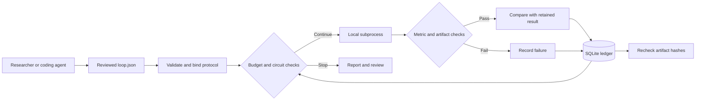

# Architecture

## Scope

Evidence Loop executes a finite, operator-reviewed plan. It does not invent
hypotheses or edit code during a run. A human or external coding agent owns those
activities. Keeping them separate makes the execution policy testable.



## Components

| Module | Responsibility |
| --- | --- |
| `config.py` | Strict JSON parsing, validated fields, portable paths, configuration identity. |
| `store.py` | SQLite attempt transactions, exclusive runner lock, interruption recovery. |
| `runner.py` | Budget policy, process lifecycle, evidence checks and retention decision. |
| `submission.py` | Strict CSV parsing, alignment, numeric checks and prediction blending. |
| `cli.py` | Explicit execution consent, commands, JSON results and Markdown reporting. |
| `templates/` | Packaged, offline example and agent instructions. |

## Attempt State

```text
not attempted -> running -> succeeded -> keep or reject
                        -> failed    -> reject
                        -> interrupted -> reject
```

`not attempted` is absence from the ledger, not a stored state. Retry creates a
new numbered attempt; it does not mutate the old result. A normal `run` skips all
previously attempted tasks, including failures.

After acquiring the exclusive workspace lock, a runner converts leftover
`running` rows into `interrupted`. This means the previous result was not
committed; it does not prove that the old process tree has stopped.

## Decisions

The first verified score establishes the reference. Each later verified score
is compared with the most recently retained score in the configured direction.
The directional delta must be strictly greater than `min_delta`.

Rejected successes remain useful evidence. Failed or interrupted attempts cannot
become the retained result. There is no fallback to a leaderboard score, no
cross-metric ranking, and no automatic significance claim.

## Persistence and Recovery

SQLite protects committed state transitions, and the workspace lock prevents two
normal local runners from scheduling simultaneously. The lock file stays in
place so waiting processes refer to the same inode; the OS releases its lock
when the process exits.

The configuration is fingerprinted on the first run. Each successful attempt
records hashes for metrics, required artifacts, logs and provenance. Before new
work, previously successful evidence is rechecked. Modified evidence blocks
continuation rather than silently changing the reference.

Provenance captures command arguments and hashes of workspace files that appear
as literal argv entries. It does not traverse imports, fingerprint a dataset
automatically, snapshot containers, or capture the full dependency environment.
Use your experiment artifacts to preserve those details when needed.

## Why a Small Local Tool?

The useful improvement over a document-only loop is not another role name.
It is explicit state, actual execution, testable stopping conditions and inspectable
evidence. Model orchestration, distributed scheduling and remote submission are
separate concerns and are deliberately absent from v0.1.
