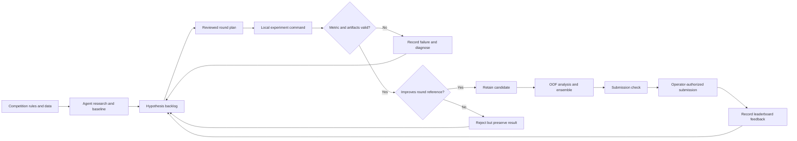

# Architecture

## Two Layers

MedalLoop is a competition Agent workflow plus a deterministic round runner.

The Agent layer is expressed in the generated `AGENTS.md` and campaign memory.
It can be used by an external coding agent and is responsible for rules, research,
validation design, implementation, interpretation and next-round decisions.

The runner is responsible only for reproducible execution mechanics:

| Module | Responsibility |
| --- | --- |
| `config.py` | Strict round plan parsing, metric direction and configuration identity. |
| `store.py` | SQLite attempt ledger, exclusive runner lock and interruption recovery. |
| `runner.py` | Process execution, budgets, evidence checks and keep/reject decisions. |
| `submission.py` | Strict CSV checks, ID alignment and mean/rank blending. |
| `cli.py` | Competition scaffolding, run commands and reports. |

## Important Separation

The runner verifies that an evaluator produced the declared metric and files.
It does not know whether the split is correct, the metric code matches the official
implementation, labels leaked, the improvement is statistically stable or the
competition rules permit a data source. Those are Agent/operator review responsibilities.

Maker, Checker and Verifier are responsibilities rather than automatically
independent model instances. Do not claim independent review unless separate
reviewers were actually used.
